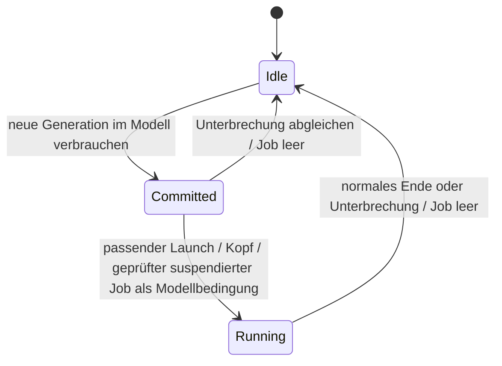

# Produktstart P1: Reiner Typ- und Zustandsvertrag

Stand: 17. November 2026. P1 des
[Integrationsentwurfs](../data-format/product-start-integration-v1-draft.md) als **reines,
testexklusives Forschungsmodell** umgesetzt. Kein Produktbootstrap, nativer Start, MAC-Nachweis oder
Datenzugriff. Striktes Datenschutzziel und offene Produkt-Q-01/Q-02 unverändert.

Dieser Abschnitt beschreibt den P1-Prüfstand `36bfbd6`. Inzwischen verwendet
[P2a](product-start-p2a-records.md) den reinen Kern unter Windows nach nativen Kontrollprüfungen.
Die Aussagen zur ausschließlichen Testeinbindung gelten für P1; der Kern selbst bleibt ohne I/O/
Authentisierung, P2a persistiert ausschließlich authentisierte Kontrollaktionen.

## Umsetzung und Autoritätsgrenze

[`product_start.rs`](../../scripts/runtime-isolation/probe/src/product_start.rs) ist ausschließlich
über `#[cfg(test)]` in [`main.rs`](../../scripts/runtime-isolation/probe/src/main.rs) eingebunden.
[`tests.rs`](../../scripts/runtime-isolation/probe/src/product_start/tests.rs) enthält sieben neue
Tests. Kein neuer CLI-Befehl, keine App-/Transport-/Installeränderung oder neue Abhängigkeit.
`unsafe` ist im Modell verboten; keine Datei-, Schlüssel-, Netzwerk-, Uhr-, Token-, Prozess- oder
UI-Operation. Nur Test-/Clippy-Ziele kompiliert, kein neuer Laufzeitbuild der Helfer-/Desktop-EXE.

`WorkspaceBindingV1` bindet die vorgeschlagene Kontrollschema-Version 5, Installation,
Arbeitsablage, Profil, Broker-/UI-Paket, Konfiguration, kanonischen Rootdigest sowie
Arbeitsablagenformat und Offline-Policy. Dies **implementiert kein natives Kontrollschema 5**. Der
bisherige Store und seine Paketdeklaration bleiben unverändert bei den bisher unterstützten
Versionen.

`StartProposalV1` hat genau `version`, `purpose`, `binding`, `launchId`, `generation`,
`expectedHead` und `bootstrapTimeoutMs`. Version 1, Zweck `workspace-start`; keine
Task-/Import-/Dateifelder oder `automatic`-Freigabe. UUIDs als nichtleere 16-Byte-Arrays, Digests
als nichtleere 32-Byte-Arrays; Arraylänge und Bytewerte streng typisiert.
Binding-/Arbeitsablagen-/Policy-Version jeweils 1, vorgesehenes Kontrollschema 5, Bootstrapfrist
1–30.000 ms, positive Generation.

Parsergrenze: höchstens 8.192 JSON-Payloadbytes, keine unbekannten oder doppelten Felder, keine
zweiten angehängten JSON-Werte. Ergebnis heißt bewusst `UntrustedStartProposal`: syntaktisch gültig
ist nicht authentisiert. Kein MAC-Schlüssel, kein autorisierter Kindhandle und keine ausführbare
Startberechtigung werden erzeugt. Die 16-KiB-Framegrenze des Entwurfs und die reale monotone Frist
sind noch nicht implementiert. Der bestehende Forschungs-Transport mit eigenem 2.048-Byte-Frame
wurde nicht erweitert oder an dieses Modell angeschlossen.

`StartModel` ist nicht deserialisierbar und nicht serialisierbar; es ist kein dauerhafter Store.
`ModelConditions` beschreibt angenommene Modellbedingungen, keine geprüften OS-/MAC-Tatsachen.
Vorgegebene Modellköpfe sind keine berechneten Kontroll-MACs. Ein späterer Broker muss diese Fakten
unabhängig authentisiert gewinnen und vor Ausführung dauerhaft festschreiben. Kein Produktionspfad
verwendet das Modell als Sicherheitsgrenze.

## Zustandsregeln



Vor Modell-Commit: exakte Bindung, konsistente Kontrolle, kein Pending, leerer Job, Idle, aktueller
Kopf, neuer nichtleerer Kopf, genau nächste Generation, unbenutzte Launch-ID und mindestens zwei
freie Modellrecords. Erst nach allen Prüfungen wird verändert. Ein Slot bleibt für Abschluss oder
Unterbrechungsabgleich reserviert. Kopf/Gegenereignis/Phase müssen auch beim Startfortschritt und
Abschluss passen. Fremde/unklare/laufende Jobs werden nicht übernommen.

Normales Ende erhält Binding/Profil und verbrauchte Launch-IDs. Unterbrechung nach Commit oder
modelliertem Running verbraucht die Generation ebenfalls dauerhaft **innerhalb dieses Modells**; ein
neuer Versuch braucht neue ID und nächste Generation. Kein Importauftrag wird erzeugt oder
zurückgesetzt. Alle getesteten Ablehnungen erhalten den vollständigen vorherigen Modellzustand. Das
Modellbudget ist bewusst auf höchstens 256 Records begrenzt; kein produktives Checkpointing, keine
Langzeit-/Neustartpersistenz und keine Bereinigung der Replayhistorie implementiert.

## Prüfung und Fortsetzung

Sieben neue Tests prüfen Payload-/Versions-/Zweckgrenzen und falsche Datentypen, alle sieben
kontextabhängigen ID-/Paket-/Root-/Konfigurationsbindungen, Pending/inkonsistente Kontrolle/Jobs,
Commit vor Running, normales Ende, Unterbrechung, Replay, veraltete/ungültige Köpfe,
Generationslücke/-überlauf und Budget einschließlich reserviertem Abschluss. Modellseed mit defekter
Bindung/leerem Kopf/zu großem Budget wird abgewiesen. Keine große kombinatorische Matrix.

```powershell
cargo test --locked --manifest-path scripts/runtime-isolation/probe/Cargo.toml
cargo clippy --locked --manifest-path scripts/runtime-isolation/probe/Cargo.toml --all-targets -- -D warnings
cargo fmt --manifest-path scripts/runtime-isolation/probe/Cargo.toml --check
```

63 aktive Tests unter Windows bestanden: sieben Transporttests und 56 im Helfer-Testziel, vier
bisherige Tests weiter ignoriert. Clippy, Format-/Diff-/Quellen-/Verweisprüfung grün. Gezielte
Helferprüfung gemäß AGENTS-Ausnahme; kein `pnpm check`, Appbuild, zusätzlicher nativer P1-Lauf oder
neuer ETW-Vergleich. Keine echten Projektdaten/ACLs/Schlüssel geändert. Gesicherte
Forschungsprogramme und ihr [letzter ETW-Beleg](native-prepare-transition-etw.md) bleiben separat
unverändert gebunden.

Nächster begrenzter Schritt **P2a**: authentisierte persistente Arbeitsablagenbindung und
Launch-Record-Lebenszyklus im nativen Forschungsbroker, ausschließlich frische synthetische Wurzeln,
zunächst ohne GUI-Start. Dabei erst Kompatibilitätsdeklaration/Schemaübergang, Kontroll-MACs/Replay
und Crash-Reconciliation umsetzen und prüfen. Danach P2b Bootstrap/Token/Job für einen synthetischen
Start ohne Importtask. Bestandsübernahme P3 und normale Produktintegration P4/P5 bleiben offen;
keine Forschungsautorität auf echte Daten übertragen.
